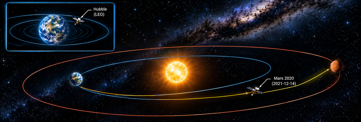

# Órbitas Espaciales en Tiempo Real

[](https://www.python.org/)
[](LICENSE)
[](.github/workflows/tests.yml)
[](https://rodolfojara.github.io/orbitas-espaciales-en-tiempo-real/)

**Estima dónde está una nave incluso cuando el webcast deja de transmitir.**

Mantiene un estado (posición y velocidad), lo propaga con un modelo físico y lo
corrige con cada medición que llega. Si la señal se corta, sigue estimando y
muestra cuánta incertidumbre acumula.



> Los ejemplos suborbitales (Starship) son **ilustrativos**, no datos reales.
> Lo que viene de CelesTrak, JPL Horizons o Space-Track está marcado como real.

## En dos minutos

Requiere Python 3.11 o superior.

```bash
python -m venv .venv
# Windows: .venv\Scripts\activate    macOS/Linux: source .venv/bin/activate
pip install -e .
python examples/run_demo.py     # genera las gráficas en examples/output/
python tests/test_basic.py      # comprobación rápida
```

Abre `examples/output/trajectory.png` y `time_series.png`. La línea roja marca
los tramos sin señal: el filtro sigue estimando y la banda ±2σ crece.

### Entradas y resultados reproducibles

```bash
python examples/run_reproducible_demo.py           # genera los resultados
python examples/run_reproducible_demo.py --check   # PASS si no cambiaron
```

Entrada fija: `examples/data/measurements.csv` (1320 mediciones). Salida y tabla
de resultados: [`examples/output/reproducible/RESULTS.md`](examples/output/reproducible/RESULTS.md).
El CI ejecuta la comprobación en cada push.

## ¿Qué quieres ver?

| Objetivo | Comando | Datos |
|---|---|---|
| Tu nave con tus mediciones | `orbitas-rt track mis_mediciones.csv --out salida/ --extra 120` | CSV propio + EKF |
| Satélites reales en órbita terrestre | `python examples/run_leo_ground_track.py` | CelesTrak TLE + SGP4 |
| Nave rumbo a la Luna, L1/L2 o Marte | `python examples/run_lunar.py --sc -1024` / `python examples/run_mars.py --sc -74` | JPL Horizons |
| Espacio profundo o etapas "perdidas" | `python examples/run_deep_space.py --sc -98` / `python examples/run_lost_objects.py --sc -399080` | JPL Horizons |
| Posición "en vivo" con antigüedad y calidad | `python examples/run_live_track.py --method satnogs` | TLE + EKF + observaciones |
| Buscar por nombre/alias y ver el panel web | `python examples/serve.py` → `http://localhost:8000/dashboard.html` | Todas las anteriores |

`orbitas-rt sources --mission starship` muestra qué fuentes están verificadas.

## Coordenadas, en una frase

TLE + SGP4 → lat/lon sobre el mapa para órbita terrestre; vectores de Horizons
relativos a la Tierra (`@399`) para cislunar, al Sol (`@sun`) para el viaje a
Marte o más allá, y a Marte (`@499`) para una órbita marciana.
Detalle: [docs/COORDINADAS.md](docs/COORDINADAS.md).

## Servidor local

```bash
python examples/serve.py      # o doble clic en examples/serve.bat
```

- `http://localhost:8000/dashboard.html` — panel unificado
- `http://localhost:8000/query.html` — consulta por NORAD, órbitas y fecha
- `http://localhost:8000/tracking_stations.html` — estaciones con filtros
- APIs: `/api/lookup`, `/api/deep_search`, `/api/horizons`, `/api/stations`, `/api/query`

La búsqueda profunda cruza fuentes, valida la frescura del TLE, marca conflictos
y guarda caché por 6 horas. GNSS y óptico son simulados; SatNOGS es real pero
limitado. Ambos casos están etiquetados en la interfaz.

## Documentación

- [Todos los comandos y ejemplos](docs/COMANDOS.md)
- [Qué pruebas existen y qué no está validado](docs/PRUEBAS.md)
- [Marcos de referencia](docs/COORDINADAS.md)
- [Fuentes de datos](docs/SOURCES.md)
- [Estaciones y organismos](docs/TRACKING_ORGANIZATIONS.md)
- [Space-Track.org (opcional)](docs/SPACETRACK_SETUP.md)

## Limitaciones

- Altitud y rapidez no fijan la distancia recorrida: se infiere con el modelo
  (error de unos pocos km).
- El modelo del filtro es 2D y simplificado; una nave real maniobra.
- El perfil de vuelo suborbital es inventado: sustitúyelo por el de la misión real.

MIT.
