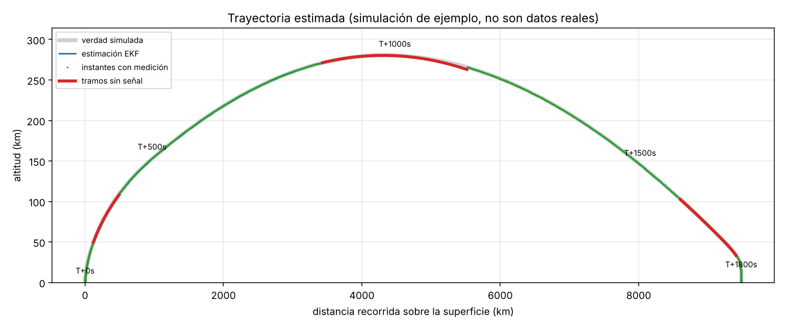
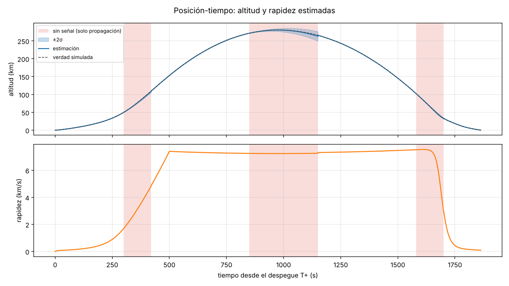
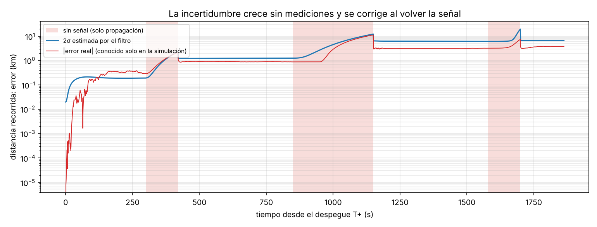

# Órbitas Espaciales en Tiempo Real

[](https://www.python.org/)
[](LICENSE)
[](tests/test_basic.py)
[](https://rodolfojara.github.io/orbitas-espaciales-en-tiempo-real/)

Estimación de la posición de una nave **en todo momento**, incluso cuando el
webcast deja de mostrar datos.


La idea: mantener un **estado** (posición y velocidad), **propagarlo** con un
modelo físico y **corregirlo** cada vez que llega una medición (por ejemplo,
la altitud y la velocidad que muestra el overlay de la transmisión). Si la señal
se corta, el filtro sigue estimando y muestra cuánta **incertidumbre** acumula.

> **Importante:** los ejemplos de este repositorio son una **simulación
> ilustrativa** de un vuelo suborbital tipo Starship. No son datos reales de
> ningún vuelo (ni de S42 ni de Artemis).

## Resultado de ejemplo

Trayectoria (altitud vs distancia recorrida). En rojo, los tramos donde se
simula que se cae la transmisión:



Posición-tiempo: altitud y rapidez estimadas, con banda ±2σ:



Incertidumbre vs error real. Sin mediciones la incertidumbre crece; al volver
la señal el filtro se corrige:



### Ejemplo posición-tiempo (`examples/output/track.csv`)

| T+ (s) | lat | lon | dist. (km) | alt. (km) | vel. (km/s) | ±σ dist. (km) | señal |
|---:|---:|---:|---:|---:|---:|---:|:--:|
| 0 | 25.9970 | -97.1570 | 0.00 | 0.00 | 0.000 | 0.01 | NO |
| 120 | 25.9893 | -97.0755 | 8.19 | 10.44 | 0.195 | 0.10 | sí |
| 300 | 25.8785 | -95.9564 | 120.78 | 49.67 | 1.694 | 0.10 | NO |
| 360 | 25.7306 | -94.5831 | 259.23 | 76.38 | 3.120 | 0.42 | NO |
| 420 | 25.4542 | -92.2922 | 491.02 | 108.03 | 4.823 | 1.15 | NO |
| 500 | 24.7746 | -87.6124 | 968.18 | 153.01 | 7.392 | 0.61 | sí |
| 900 | 18.1043 | -61.3280 | 3782.63 | 277.09 | 7.237 | 0.76 | NO |
| 1000 | 15.8926 | -55.2341 | 4475.66 | 279.98 | 7.234 | 2.26 | NO |
| 1150 | 12.2647 | -46.3301 | 5517.06 | 262.92 | 7.255 | 6.09 | NO |
| 1300 | 8.2629 | -37.4741 | 6583.10 | 228.41 | 7.358 | 3.11 | sí |
| 1700 | -2.9979 | -14.6469 | 9407.29 | 33.15 | 2.973 | 9.72 | NO |
| 1863 | -3.2938 | -14.0514 | 9481.14 | 0.07 | 0.091 | 3.26 | sí |

`señal = NO` significa que en ese instante no había medición y el valor es
solo propagación del modelo. `examples/output/track.geojson` se puede abrir
directamente en GitHub (se dibuja sobre un mapa).

## Fuentes de datos

El proyecto lleva un **registro de fuentes** con sus pros y contras, para tener
varias alternativas de dónde sacar datos según la misión (Starship, Artemis,
espacio profundo, LEO) y saber cuáles ya se comprobaron:

- Documento legible: [`docs/SOURCES.md`](docs/SOURCES.md)
- Fuente de verdad (editable): [`src/orbitas_rt/sources.json`](src/orbitas_rt/sources.json)
- Consulta rápida: `orbitas-rt sources --mission starship`

Cada fuente marca si está `verificada` (con fecha) o `sin verificar`. Antes de
depender de una fuente `sin verificar`, confirma su URL, formato y condiciones de uso.

## Uso

```bash
python -m venv .venv && source .venv/bin/activate   # Windows: .venv\Scripts\activate
pip install -e .            # o: pip install -r requirements.txt
python examples/run_demo.py # regenera CSV, GeoJSON e imágenes
python tests/test_basic.py  # pruebas (o: pytest)
```

Con tus propias mediciones (CSV con columnas `t_s, altitude_km, speed_kmh`,
ver `examples/data/measurements.csv`):

```bash
orbitas-rt track mis_mediciones.csv --out salida/ --extra 120
```

`--extra` propaga el estimado N segundos más allá de la última medición, que es
exactamente el caso "se cortó la transmisión".

Para leer los números directamente del video del webcast hay un módulo
**experimental** (`src/orbitas_rt/ocr.py`, usa OCR). No está probado contra un
webcast real.

## Cómo funciona

| Pieza | Archivo | Qué hace |
|---|---|---|
| Modelo dinámico | `dynamics.py` | Gravedad + empuje nominal + arrastre (2D, marco inercial) |
| Filtro | `ekf.py` | Filtro de Kalman extendido: `predict()` y `update()` |
| Simulación | `sim.py` | Trayectoria "real", mediciones tipo overlay (enteros en km y km/h) y cortes de señal |
| Geografía | `geo.py` | Distancia recorrida → latitud/longitud (gran círculo) |
| Gráficos | `plotting.py` | Las tres imágenes de ejemplo |
| Fuentes | `sources.py`, `sources.json` | Registro de fuentes de datos con pros y contras |

El estado es `[x, y, vx, vy]`. La medición es `[altitud, rapidez]`. El ruido de
proceso (`q_burn`, `q_coast` en `ekf.py`) representa lo que el modelo no sabe:
variaciones de empuje, viento, maniobras. En la simulación, la "verdad" difiere
del modelo en parámetros de empuje y arrastre, y además incluye un **encendido
no anunciado** durante un corte de señal (T+950 a T+980 s) para mostrar qué pasa
cuando ocurre algo que el modelo no puede adivinar.

## Visualización orbital

Además de las gráficas del filtro, el paquete incluye dos visualizaciones orbitales
(`src/orbitas_rt/viz.py`):

- **Huella en tierra (ground track)** para órbita baja/media (LEO/MEO): proyecta la
  órbita sobre la superficie terrestre (lat/lon del punto sub-satélite). Incluye
  versión en proyección ortográfica (globo) para evitar la distorsión de la
  proyección plana.
  ```bash
  python examples/run_leo_ground_track.py
  ```

- **Trayectorias Starship (ilustrativas, no datos reales)** sobre el mapa mundial:
  ```bash
  python examples/run_starship_track.py
  ```
  Genera una trayectoria orbital (~15 órbitas LEO) y un arco suborbital del booster (~8 min).

- **Reentrada y aproximación (Starship Flight 15)**: órbita + arco de reentrada desde el Golfo:
  ```bash
  python examples/run_starship_reentry.py
  ```

- **Órbita REAL desde CelesTrak** (Starlink desplegado por Starship Flight 15, SGP4):
  ```bash
  python examples/run_real_starlink.py
  ```

- **Trayectorias lunares (cislunar)** desde JPL Horizons (LRO, Danuri, Artemis, etc.):
  ```bash
  python examples/run_lunar.py --list
  python examples/run_lunar.py --sc -85
  ```

- **Trayectorias marcianas (heliocéntricas)** desde JPL Horizons (MRO, Perseverance, etc.):
  ```bash
  python examples/run_mars.py --list
  python examples/run_mars.py --sc -74
  ```

- **Trayectorias en espacio profundo** (más allá de la Luna) desde JPL Horizons:
  ```bash
  python examples/run_deep_space.py --list
  python examples/run_deep_space.py --sc -98   # New Horizons
  python examples/run_deep_space.py --sc -31    # Voyager 1
  ```

- **Determinación de órbitas** (batch least squares, Gauss-Newton):
  ```bash
  python examples/run_od.py
  ```

- **Mapas web cislunar y marciano** (canvas, sin tiles):
  ```bash
  python examples/serve.py
  # abrir http://localhost:8000/lunar_map.html
  # abrir http://localhost:8000/mars_map.html
  ```

- **Estaciones de rastreo de satélites** (mapa mundial con filtro por operador, región, tipo):
  ```bash
  python examples/serve.py
  # abrir http://localhost:8000/tracking_stations.html
  ```
  Incluye NASA DSN, ESA ESTRACK, Roscosmos, CNSA, KSAT, SSC, CONAE, SANSA, etc.
  Incluye Peldehue/Colina (Chile, NASA→U. de Chile→SSC) y estaciones en Argentina.
  Documentación de organismos: `docs/TRACKING_ORGANIZATIONS.md`.

- **Seguimiento en vivo** (TLE + EKF 3D, actualiza cada segundo):
  ```bash
  python examples/run_live_track.py --method gnss   # o satnogs / optical
  python examples/run_live_track.py --auto --method satnogs  # elige sat con obs recientes
  # abrir http://localhost:8000/live_track.html
  ```
  Muestra posición TLE, EKF estimada, última medición real y su antigüedad.

- **Consulta orbital interactiva** (formulario web + API):
  ```bash
  python examples/serve.py   # o doble clic en examples/serve.bat
  # abrir http://localhost:8000/query.html
  ```
  Permite consultar por NORAD ID, número de órbitas, paso y fecha de inicio.
  Genera la trayectoria proyectada sobre el mapa con día/noche.

- **Satélites chilenos (reales, CelesTrak + SGP4)**: SUCHAI-4, FASAT B, SSOT:
  ```bash
  python examples/run_chile_satellites.py
  ```

- **Diagrama interplanetario** para órbita alta, Tierra-Luna, Tierra-L2 o Tierra-Marte:
  muestra las órbitas de los planetas y la trayectoria del objeto en coordenadas
  heliocéntricas (eclíptica). Incluye un ejemplo con datos reales de ESCAPADE
  (NASA) rumbo a Marte, obtenidos de JPL Horizons:
  ```bash
  python examples/run_escapade.py
  ```

- **Modelo 3D con rotación terrestre** (`src/orbitas_rt/orbit3d.py`): propagación ECI con
  gravedad + J2 y conversión a geodésicas considerando la rotación terrestre (GMST).
  Genera una órbita 3D y su huella en tierra:
  ```bash
  python examples/run_orbit3d.py
  ```

- **Visualización web (Leaflet)**: mapa interactivo de la huella en tierra, autocontenido
  (abre el HTML en cualquier navegador):
  ```bash
  python examples/run_web_ground_track.py
  ```

## Limitaciones (léelas antes de usarlo con datos reales)

- **Altitud y rapidez no bastan para fijar la distancia recorrida.** Esta se
  infiere con el modelo, por eso aparece un error de unos pocos km que no se
  elimina del todo. Una medición de posición real (por ejemplo, el ícono de la
  nave en el mapa del webcast, o datos de radar/NOTAM) lo mejoraría mucho.
- **Modelo 2D simplificado:** sin rotación terrestre, sin viento, sin
  sustentación, vuelo coplanar con acimut fijo. Una nave real maniobra.
- **Marco de la velocidad:** si el overlay da velocidad respecto de la
  superficie y el modelo usa velocidad inercial, hay un sesgo sistemático
  (hasta ~0.4 km/s en el ecuador) que hay que corregir.
- **El perfil de vuelo es inventado.** Para una misión real hay que reemplazar
  `VehicleParams` por el perfil publicado de esa misión.
- **Una maniobra no anunciada durante un corte** no se puede predecir; solo se
  corrige cuando vuelven las mediciones.

## Hoja de ruta

- [ ] Modo "en vivo": leer mediciones de un stream y emitir la estimación cada segundo.
- [ ] Medición de posición (lat/lon) además de altitud y rapidez.
- [ ] Modelo 3D con rotación terrestre.
- [ ] Espacio profundo / Artemis: leer efemérides y estados desde JPL Horizons y
      kernels SPICE (`spiceypy`), propagar con N cuerpos (Tierra, Luna, Sol) y
      corregir con Doppler.
- [ ] Visualización web (Leaflet / CesiumJS).
- [ ] Probar y marcar como `verificada` cada fuente de `sources.json` (ver `docs/SOURCES.md`).

## Licencia

MIT.
